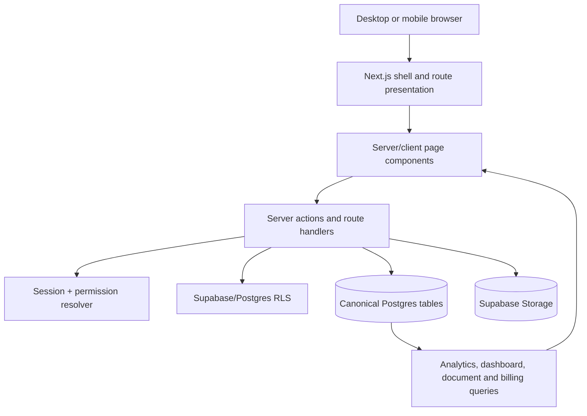
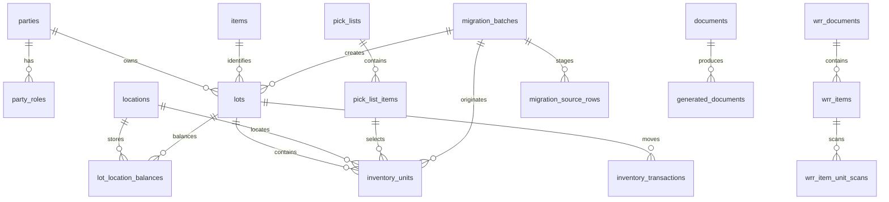
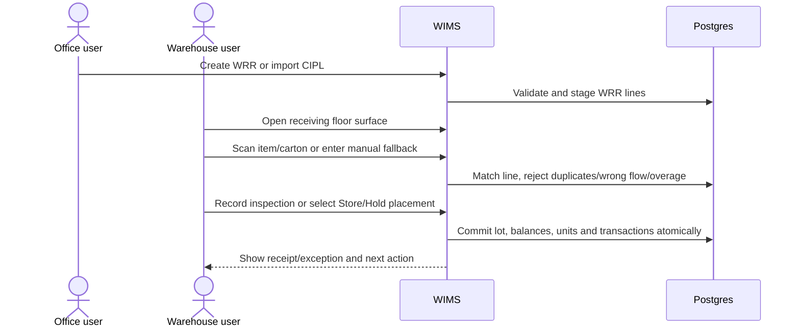
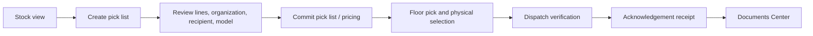
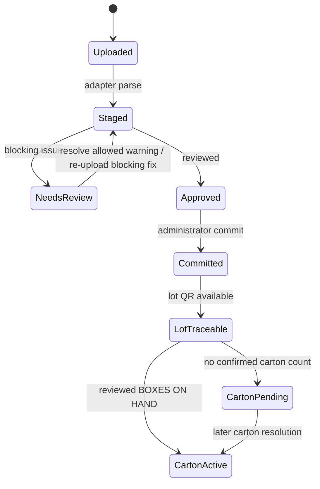

# Dyna-Serv WIMS — System Documentation

**Document type:** Technical and administrative reference  
**System:** Dyna-Serv Warehouse Inventory Management System (WIMS)  
**Version:** 1.1  
**Evidence baseline:** Repository inspection, approved specifications, source code, database migrations, and automated tests inspected 2026-10-27  
**Audience:** Developers, system administrators, IT personnel, technical evaluators, maintainers, and project stakeholders

> This document describes the implemented repository behavior. A feature marked **planned**, **deferred**, **draft**, or **not verified** must not be treated as production behavior.

For operational instructions, use the [Unified User Manual](USER_MANUAL.md) and its [companion-guide library](user-manual/README.md). This system document explains how the system is built; the user manual explains how authorized users operate it.

## Contents

1. [System introduction](#1-system-introduction)  
2. [Architecture and design](#2-architecture-and-design)  
3. [Route and module inventory](#3-route-and-module-inventory)  
4. [Data architecture](#4-data-architecture)  
5. [Security and access control](#5-security-and-access-control)  
6. [Business workflows](#6-business-workflows)  
7. [QR, scanning, and print architecture](#7-qr-scanning-and-print-architecture)  
8. [Errors, consistency, and recovery](#8-errors-consistency-and-recovery)  
9. [Deployment and operations](#9-deployment-and-operations)  
10. [Testing and verification](#10-testing-and-verification)  
11. [Technical appendices](#11-technical-appendices)  
12. [Coverage checklist and revision history](#12-coverage-checklist-and-revision-history)

**Figures:** Figure 1 layered architecture; Figure 2 canonical ERD; Figure 3 receiving sequence; Figure 4 inventory-to-dispatch flow; Figure 5 migration state flow.  
**Key tables:** route catalog; module implementation contracts; database dictionary; permission matrix; API inventory; coverage checklist.

## 1. System introduction

### 1.1 Purpose

Dyna-Serv WIMS is a single-warehouse system for managing vendor-owned inventory (VMI), warehouse-owned trading/3PL stock, and internal supplies. It manages master data, inbound receiving, inspection, location balances, pick-list commitments, dispatch, acknowledgement receipts, documents, reporting, VMI billing, trading pricing, organization-portal views, and QR/carton traceability.

The system is deliberately mobile-first for warehouse-floor work and office-capable for administration, reporting, configuration, and review. There is one physical warehouse; the canonical model does not use `warehouse_id`.

### 1.2 Business models

| Model | Ownership and operational meaning | Pricing/billing rule |
|---|---|---|
| VMI | Supplier/customer-owned stock held and operated by Dyna-Serv | CBM/storage and handling billing use period-level VMI rules; a document price is not the period bill |
| Trading/3PL | Dyna-Serv-owned or trading stock released to a customer | Trading price on the document is final; buying/selling margin is tracked |
| Supplies | Internal warehouse-use stock | Operational inventory flow; not treated as customer VMI |

### 1.3 Scope and limitations

Implemented scope includes the registered launch routes in `lib/shell/registry.ts`, the canonical schema and migrations, server actions, API routes, responsive UI components, QR flows, and test suites. The route registry identifies `/portal/notifications` and `/portal/labels` as planned. Dispatch scheduling and delivery tracking (`19`) is explicitly deferred. Runtime camera and some Playwright hardware simulation remain implementation work even though their contracts are approved.

The repository is not evidence of a deployed production environment, configured credentials, physical printer settings, or a completed real-Postgres migration run unless a test or deployment record explicitly proves it.

### 1.4 Stakeholders and roles

The RBAC model distinguishes administrator, supervisor, warehouse staff, organization/party users, and technical/support actors. Exact access is grant-based rather than inferred from navigation visibility. A route can be hidden from a user's navigation and still requires server-side authorization when directly addressed.

Core operational responsibilities are:

- **Administrator:** system configuration, user/role administration, master data, migration, rate/contract configuration, approvals where granted, and operational oversight.
- **Supervisor:** receiving/inspection oversight, approvals and financial/reporting access where granted, exception review, and operational supervision.
- **Warehouse staff:** floor receiving, scanning, putaway, picking, dispatch verification, and physical discrepancy handling.
- **Party/portal user:** organization-scoped inventory, orders, documents, and permitted portal views.
- **Developer/IT operator:** deployment, migrations, environment configuration, monitoring, backup, restoration, and incident response; not an application business role unless separately granted.

### 1.5 Nonfunctional principles

- Mobile-first, floor-priority operation with large touch targets and a single primary action.
- Canonical naming: `parties`, `items`, `locations`; not `suppliers`, `SKU`, or `bins`.
- Server-side authorization at every data boundary.
- Database-enforced integrity and RLS for sensitive mutations.
- Idempotent commands for approvals, migration, document generation, and physical-unit creation where specified.
- Permanent retention policy for `audit_log`, `lot_history_export`, and generated document artifacts, using verified hot/cold tiering.
- Accessible mobile presentation: horizontally scrollable data tables are converted to labeled cards on narrow screens where the shared enhancer applies.

## 2. Architecture and design

### 2.1 Technology stack

| Layer | Implemented technology/evidence |
|---|---|
| Application | Next.js App Router, React, TypeScript |
| Styling | Tailwind utilities plus `app/globals.css` semantic design tokens |
| Data access | Drizzle ORM schema with Postgres/Supabase client |
| Authentication | Supabase authentication callback/session utilities |
| Authorization | RBAC grants, route guards, server permission checks, Supabase/Postgres RLS |
| Storage | Supabase storage for source files and document attachments where configured |
| QR | `react-qr-code`, shared payload/parser helpers |
| Scanning | `html5-qrcode` contract and `MobileQRScanner` component; runtime coverage is still being completed |
| Testing | Vitest, Testing Library, TypeScript; Playwright strategy in approved testing specifications |
| Deployment target | Vercel + Supabase, as locked in `specs/00-steering/tech.md` |

### 2.2 Layered request model

Server components are used for authenticated data reads and page composition. Client components handle scanner input, modal state, interactive forms, filters, print previews, and browser-only capabilities. Server actions re-check permissions; the client is never the authorization boundary.

### 2.3 Shell surfaces

The shell declares four surfaces:

- **Floor:** receiving, pick, and dispatch screens optimized for handheld use.
- **Office:** reports, documents, master data, billing/pricing, migration, settings, and approvals.
- **Shared:** dashboard, inventory, profile, and common routes available in both presentation contexts.
- **Party:** organization-portal screens scoped to the authenticated party.

The route registry is a typed catalog, not an authorization mechanism. `filterVisibleRoutes()` filters presentation using grants; `requirePermission()` and RLS enforce the actual boundary.

### 2.4 UI component system

The shared UI library is in `components/ui/`. It includes cards, buttons, badges, alerts, inputs, selects, textareas, switches, radios, tabs, modals, pagination, status badges, loading states, empty states, typography, filters, shared icons, mobile data cards, and the mobile table enhancer. Icons are re-exported from `components/ui/icons.ts` so the icon vendor can be swapped centrally.

Filter controls use `FilterSearchInput`, `FilterSelect`, and `FilterDateInput`. Their native controls are marked with `data-filter-control` to prevent global form styling from changing their geometry. This is the application-wide consistency boundary for search, select, date, and filter controls.

Tables have desktop presentation and mobile card presentation where the shared enhancer or an explicit card renderer applies. A mobile table card uses the desktop column header as its `data-mobile-label`; it must not require horizontal scrolling for ordinary use.

### 2.5 External services and integrations

| Service/integration | Use | Configuration/evidence | Failure boundary |
|---|---|---|---|
| Supabase Auth/SSR | Sign-in, callback, session and user identity | `NEXT_PUBLIC_SUPABASE_URL`, publishable/anon key, server session helpers | Authentication failure; no business mutation should proceed without a valid session |
| Supabase Postgres/RLS | Canonical data, constraints, transactions and row-level scope | `DATABASE_URL`/`POSTGRES_URL`, Drizzle schema, SQL migrations | Transaction rollback, query error, or denied row scope |
| Supabase Storage | CIPL/source files, generated PDFs and evidence attachments | Storage policies and server storage helpers | Artifact unavailable or unauthorized; source transaction remains authoritative |
| Vercel/Next.js runtime | Web deployment, route handlers and server actions | `NEXT_PUBLIC_APP_URL` and deployment environment | Runtime/build/route failure; health endpoint and logs are first checks |
| Resend/Supabase email | Invitation and notification delivery | `INVITATION_EMAIL_PROVIDER`, `RESEND_API_KEY`, `RESEND_FROM_EMAIL` | Delivery failure is not permission success; retry/escalate through admin operations |
| Upstash Redis | Request/rate limiting | `UPSTASH_REDIS_REST_URL`, `UPSTASH_REDIS_REST_TOKEN` | Rate-limit service failure must fail safely or be observable; never expose tokens |
| Sentry | Error and performance monitoring | DSN/org/project/build auth variables | Monitoring failure must not expose secrets or block core transaction semantics |
| Browser camera/thermal printer | QR scanning and label output | Browser permission, `html5-qrcode`, printer driver/dialog | Device capability failure uses manual fallback or controlled print verification |

Integration secrets are server/deployment configuration. They must never appear in this document, source logs, screenshots, or support tickets.

## 3. Route and module inventory

### 3.1 Launch route catalog

| Route | Surface | Purpose | Primary capability |
|---|---|---|---|
| `/` | Shared | Dashboard/home landing | none |
| `/receiving` | Shared | WRR list and inbound queue | `receiving.view` |
| `/receiving/[wrrId]` (`/receiving/[wrr_id]` in the route contract) | Floor | WRR detail and receiving workflow | `receiving.view` |
| `/receiving/new` | Floor/office | Create a WRR and its lines | receiving grants |
| `/inventory` | Shared | Master inventory, stock view, pick lists, inspection | `pick_list.read` |
| `/outgoing` | Shared | Outgoing/pick queue | `pick_list.execute` |
| `/pick-lists` | Shared | Pick-list directory | pick-list grants |
| `/pick-lists/[id]/pick` (`/pick-lists/[pickListId]/pick`) | Floor | Physical picking | `pick_list.execute` |
| `/pick-lists/[id]/dispatch` (`/pick-lists/[pickListId]/dispatch`) | Floor | Dispatch verification and receipt | `dispatch.execute` |
| `/documents` | Office | Authoritative document archive | `documents.read` |
| `/approvals` | Office | Approval queue and approval details | approval grants |
| `/enrollment` | Office | Party, item, location and classification enrollment | parties/items grants |
| `/billing-pricing` | Office | Financial overview, pricing, contracts, SOA | `reporting.financial_read` |
| `/migration` | Office | One-time UBoT opening migration | administrator/master-data grants |
| `/reports` | Office | Operational, inventory, VMI, trading and audit analytics | reporting grants |
| `/master-data/items` | Office | Item catalog management | item grants |
| `/master-data/locations` | Office | Location matrix and bulk location generation | location grants |
| `/master-data/parties` | Office | Party/organization management | party grants |
| `/profile` | Shared | Current user's profile and preferences | authenticated session |
| `/settings` | Office | General, security and team settings | settings grants |
| `/portal` | Party | Organization portal landing | portal session |
| `/portal/inventory` | Party | Party-scoped inventory | `reporting.read` |
| `/portal/orders` | Party | Party-scoped orders/pick lists | `pick_list.read` |
| `/portal/documents` | Party | Party-scoped documents | `documents.read` |

The route registry also contains `/portal/notifications` and `/portal/labels` with `planned` launch status. They are not documented as available workflows.

### 3.2 Module responsibilities

#### Receiving

WRRs are created from manual form entry or CIPL import. A WRR contains lines with item, lot, expected quantity, SPQ/UOM, dates, CBM and disposition. The floor receiving screen scans item/carton labels, validates line ownership and flow type, records discrepancies, and routes accepted lines to putaway or inspection. `Store` and `Hold` are line-level commit boundaries in the current batch model; scan reconciliation remains required before commit eligibility.

#### Inventory

Inventory combines stock view, lot/location balances, item detail, pick-list generation, inspection initiation, QR viewing, opening-stock import, DRA import, and mobile card rendering. Aggregate balances remain authoritative for quantities; `inventory_units` provide optional exact carton traceability.

#### Outgoing and dispatch

Outgoing creates or reviews pick commitments. A pick list freezes relevant pricing, reserves physical units, supports floor pick confirmation, and transitions into dispatch. Dispatch validates the selected lot/item/carton, generates or serves an acknowledgement receipt, and updates committed/selected/dispatched unit state.

#### Migration

The UBoT VMI migration stages an `.xlsx` workbook, preserves the source and normalized rows, validates parties/items/locations/opening balances/rates, supports review and approval, and commits canonical opening data transactionally. `Location Matrix` is the opening-stock authority; `Inventory` is reconciliation evidence. Current migration carton traceability supports lot QR immediately, migration-origin carton units when `BOXES ON HAND` is reviewed, and deferred resolution when it is absent.

#### Reporting and analytics

Reports reads canonical query modules for inventory KPIs, WRR/pick volumes, activity heatmaps, spatial analytics, VMI consignment/storage, trading capital, conformance, outbound activity, audit/archive outputs, and exports. Report filters are presentation controls; the query layer remains the source of calculated values.

#### Billing and pricing

The billing-pricing surface contains VMI contract terms, permits, daily balances, periods, charges, payment, statement of account, trading contracts/rate cards, trading margin, logistics rates, and configuration. VMI period close uses period-level calculations. Trading documents retain final prices; VMI document pricing is a release reference and does not replace the period bill.

#### Documents

The Documents Center archives WRRs/receipts, inbound CI/PL/invoices, pick lists/DRA, delivery receipts, SOA, reports, and audit logs. It supports search, organization/date filtering, previews, downloads, reprints where permitted, and permanent artifact retention policy. Status controls are tab-specific only where the underlying table requires them; the global status-pill row was removed to avoid implying one status vocabulary across all document classes.

#### Master data and enrollment

Party enrollment maintains organizations and roles. Item enrollment maintains the shared item catalog and classification hierarchy. Location enrollment supports single and bulk generation with zones/racks/levels/positions and capacity. Material-origin organization options are constrained to the approved supplier/VMI-customer relationships and inherit the organization’s inventory model where the form contract requires it.

#### Portal

Portal surfaces are organization-scoped read/operational views. They must never expose another party's stock, documents, or orders. Planned notifications/labels routes are registry placeholders rather than current behavior.

### 3.3 Module implementation contracts

The following table is the implementation-level contract for the main modules. The source references are intentionally included so a maintainer can move from this document to the authoritative code without guessing.

| Module | UI entry points | Server/query owners | Primary data dependencies | Validation and side effects |
|---|---|---|---|---|
| Receiving | `/receiving`, `/receiving/new`, `/receiving/[wrrId]`, `/receiving/[wrrId]/receive`, receipt/print/pre-alert subroutes | `lib/actions/receiving.ts`, `lib/receiving/*`, `lib/parsers/cipl-parser.ts` | `wrr_documents`, `wrr_items`, putaway allocations, scans, lots, balances, transactions | Item/lot/model match, positive quantities, expiry for perishable items, capacity, idempotent line commit, inspection/OS&D handling |
| Inventory | `/inventory`, item detail, stock/pick/inspection tabs | `lib/db/queries/inventory.ts`, `lib/actions/inventory-migration.ts`, withdrawal actions | items, lots, balances, units, transactions, commitments | Available quantity, ownership/model scope, lot eligibility, exact-unit state, mobile card rendering |
| Picking | `/inventory?tab=pick-lists`, `/pick-lists`, `/pick-lists/[id]/pick` | `lib/actions/withdrawals.ts`, `lib/withdrawal/*`, `lib/fifo/index.ts`, `lib/parsers/dra-parser.ts` | pick lists/items, commitments, lots, locations, units, parties | SPQ multiple for Trading/VMI, FIFO/FEFO, override approval, reservation TTL, race-safe allocation |
| Dispatch | `/outgoing`, `/pick-lists/[id]/dispatch`, receipt/print routes | `lib/actions/withdrawals.ts`, `lib/barcode/*`, receipt API | commitments, pick lists, units, transactions, generated documents | Pick completion, scan evidence, duplicate protection, locked transaction, priced receipt generation |
| Migration | `/migration`, `/migration/success` | `lib/actions/data-migration.ts`, `lib/migration/*`, `/api/migration/ubot` | migration batches/source rows/exceptions, parties, items, locations, lots, units | Workbook profile/schema, reconciliation, exception resolution, approval, transactional commit, deferred carton resolution |
| Reports | `/reports` and report sections/modals | `lib/actions/reports.ts`, `lib/analytics/queries/*`, `components/reports/*` | inventory, transactions, WRRs, outbound, VMI, trading, audit and generated artifacts | Date/party scope, financial grant, export filter parity, empty-state distinction |
| Billing/pricing | `/billing-pricing` and contract/VMI/trading/SOA subroutes | `lib/billing/*`, `lib/actions/contracts.ts`, VMI/trading actions | contracts, versions, pricing rules, VMI ledgers/periods/charges/payments, trading policies | Effective dates, locked FX, period close/correction, price freeze, audit and artifact generation |
| Documents | `/documents` and document-family tables/modals | `lib/actions/documents.ts`, download API, print components | generated documents, events, CIPL storage, receipts, SOAs, report artifacts | Party scope, family-specific filters, download authorization, reprint event/watermark, permanent retention |
| Scanning/QR | Receiving scanner, floor scanner, lot/unit viewers, label generators | `lib/actions/scanner.ts`, `lib/barcode/*`, `components/barcode/*` | lots, units, WRR scan ledger, pick/dispatch state | Payload type, workflow ownership, duplicate/unit identity, camera/manual fallback, scan feedback |
| Parties/items/locations | Enrollment and `/master-data/*` routes | `lib/actions/parties.ts`, `items.ts`, `locations.ts`, `lib/enrollment/*` | parties/roles/relationships, items/categories, locations | Active-state rules, canonical role contract, unique codes, capacity and location labels, origin-model inheritance |
| Approvals | `/approvals`, `/approvals/[approvalId]` | `lib/actions/approvals.ts`, `lib/approval/*` | approval requests/decisions, policies, users | Self-approval prevention, expiry, one-time consumption, reviewer grant |
| Transfers/inspection | `/transfers`, `/transfers/new`, execute/inspect routes, `/inspection` | `lib/actions/transfers.ts`, `lib/transfer/*` | transfer requests/lines, inspection cases/evidence/dispositions, lots/locations | Quantity conservation, authorized disposition, quarantine availability, evidence attachment |
| Portal | `/portal`, inventory/orders/documents subroutes | `lib/portal/resolve-party-scope.ts`, portal queries | party scope, inventory, pick lists, documents | Organization scope at session/query/RLS layers; no cross-party visibility |
| Settings/profile | `/profile`, `/settings/*` | profile/settings actions, `lib/user-settings/*`, RBAC actions | profiles, roles, permissions, settings, security events, notifications | Session ownership, role/grant checks, protected settings mutations, auditability |
| Notifications/offline | Shared shell, scan/floor workflows | `lib/notifications/*`, `lib/offline/*`, shell connectivity/scan loop | notifications, offline queue, audit context | Deduplication, connectivity state, Tier-1 queue boundaries; privileged actions remain online-only |

### 3.4 Cross-module contracts

| Producer | Consumer | Contract |
|---|---|---|
| CIPL parser | WRR form | Parsed rows remain reviewable and editable; unresolved item matches block safe commit |
| WRR commit | Inventory | Only physically present, valid, committed quantities create lot/balance/transaction records |
| Inventory | Pick allocation | Only eligible available balances participate; reservations do not decrement physical stock |
| Pick/dispatch | Documents | Trading price is frozen on the document; VMI release price is reference-only; receipt generation is linked to the committed transaction |
| Migration | Inventory/QR | Lot provenance is preserved; carton units are created only from confirmed carton counts; lot QR remains available while carton trace is pending |
| Billing ledger | Reports/Documents | Period calculations and issued artifacts are read from locked financial records, not recomputed from presentation cards |
| RBAC/session | Every server action/API | UI visibility is advisory; authorization and party scope are rechecked at the server/database boundary |

## 4. Data architecture

### 4.1 Canonical entity relationships

### 4.2 Core tables

| Table family | Representative tables | Responsibility |
|---|---|---|
| Parties/RBAC | `parties`, `party_roles`, `user_profiles`, RBAC tables | Organizations, roles, users, grants, scopes |
| Catalog | `items`, `item_categories` | Material identity, packaging, dimensions, classification |
| Locations | `locations` | One-warehouse location/capacity model |
| Inventory | `lots`, `lot_location_balances`, `inventory_units`, `inventory_transactions` | Aggregate stock, lot identity, exact carton identity, movement ledger |
| Receiving | `wrr_documents`, `wrr_items`, `wrr_item_unit_scans`, inspections | Expected inbound lines, scan reconciliation and observations |
| Outgoing | `pick_lists`, `pick_list_items`, commitments, acknowledgement receipts | Two-stage commitment, pricing, selection, dispatch evidence |
| Documents | documents, generated documents, CIPL attachments | Archive, generated artifacts, source files |
| Approvals | approval requests and policy tables | Supervisor/authorized approval state machine |
| Billing | VMI contracts/terms/periods/charges, trading pricing, ledgers | Financial configuration and period outputs |
| Migration | `migration_batches`, `migration_source_rows`, `migration_exceptions` | Immutable source evidence, review, approval and provenance |
| Audit/notifications | audit log, notifications | Permanent traceability and user notifications |

### 4.2.1 Database dictionary and ownership map

The names below are the canonical Drizzle schema/table names. `id` is the normal UUID primary key unless the table is a settings/ledger table with an explicitly documented key. Foreign-key details are maintained in the schema files and migrations listed in Appendix B; this table gives maintainers the domain meaning and the authoritative source module.

| Table | Key fields/identifiers | Domain meaning | Source |
|---|---|---|---|
| `parties` | `id`, `code`, `name`, `is_active` | Organization/party master | `lib/db/schema/parties.ts` |
| `party_roles` | `party_id`, `role` | Canonical party role membership | `lib/db/schema/parties.ts` |
| `party_flow_relationships` | party/flow relationship fields | Allowed business-flow relationship | `lib/db/schema/parties.ts` |
| `items` | `id`, `code`, `barcode`, `uom`, `spq`, `volume_cbm`, `is_perishable`, `is_active` | Shared item catalog and packaging rules | `lib/db/schema/items.ts` |
| `item_categories` | `id`, `parent_id`, `flow_type` | Category/subcategory hierarchy | `lib/db/schema/items.ts` |
| `locations` | `id`, `label`, zone/rack/level/position, `max_cbm_capacity`, `is_active` | One-warehouse storage/location master | `lib/db/schema/locations.ts` |
| `lots` | `id`, `lot_number`, `item_id`, `owner_party_id`, `flow_type`, `status`, `carton_trace_status` | Business-batch identity and provenance | `lib/db/schema/lots.ts` |
| `lot_location_balances` | `lot_id`, `location_id`, quantity fields | Aggregate stock by lot and location | `lib/db/schema/lot_location_balances.ts` |
| `inventory_units` | `unit_id`, `carton_id`, `lot_id`, origin IDs, state/location | Exact physical carton/unit identity | `lib/db/schema/inventory_units.ts` |
| `inventory_transactions` | transaction number, lot/item, movement, locations, source IDs | Immutable movement ledger | `lib/db/schema/transactions.ts` |
| `wrr_documents` | `wrr_number`, party, flow, status, confirmation fields | Inbound expected shipment document | `lib/db/schema/wrr.ts` |
| `wrr_items` | `wrr_id`, item/lot, expected/scanned qty, disposition, `committed_at` | Inbound line and commit boundary | `lib/db/schema/wrr.ts` |
| `wrr_item_putaway_allocations` | WRR line, location, quantity | Staged split putaway plan | `lib/db/schema/wrr.ts` |
| `wrr_item_unit_scans` | `wrr_item_id`, `unit_id` | Duplicate-safe receiving scan evidence | `lib/db/schema/wrr.ts` |
| `wrr_inspection_logs` | WRR/item, inspector, conformance, reason, evidence | Receiving inspection observation | `lib/db/schema/wrr.ts` |
| `pick_lists` | `pick_list_number`, parties, flow, status, receipt fields | Outbound request and lifecycle | `lib/db/schema/pick_lists.ts` |
| `pick_list_items` | pick list, item, lot, location, qty, SPQ, boxes, price | Frozen outbound line snapshot | `lib/db/schema/pick_lists.ts` |
| `inventory_commitments` / `_lines` | commitment number, pick list, expiry/status | Reserved-but-not-yet-decremented stock | `lib/db/schema/commitments.ts` |
| `transfer_requests` / `transfer_lines` | request, source/destination, quantities | Internal movement workflow | `lib/db/schema/transfers.ts` |
| `inspection_cases` / evidence/dispositions | case, lot/transfer, findings, disposition | Quarantine/inspection resolution | `lib/db/schema/transfers.ts` |
| `migration_batches` / source rows/exceptions | batch, source row, exception category/status | Staged migration evidence and resolution | `lib/db/schema/migrations.ts` |
| `generated_documents` / `document_events` | document type, source, artifact, event type | Permanent document artifact/audit trail | `lib/db/schema/documents.ts` |
| `approval_requests` / decisions | request, policy, requester/reviewer, decision | Controlled exception approvals | `lib/db/schema/approvals.ts` |
| `contracts` / versions / parties / pricing rules | contract number, party, effective dates, rules | Commercial contract/version model | `lib/db/schema/contracts.ts` |
| `vmi_contract_terms` / permits / recurring fees | party, rates, effective dates | VMI storage/handling/permit rules | `lib/db/schema/vmi_billing.ts` |
| `vmi_daily_balance_ledger` | party/date, beginning/inbound/outbound/ending CBM | Daily VMI billing basis | `lib/db/schema/vmi_billing.ts` |
| `vmi_charge_lines` / billing periods / payments | source, amount, currency, period/status | VMI period billing and settlement | `lib/db/schema/vmi_billing.ts` |
| `trading_policies` / invoice lines | policy/order/price fields | Trading price and margin behavior | `lib/db/schema/trading_pricing.ts` |
| `audit_log` | actor, action, entity, before/after/context | Permanent accountability record | `lib/db/schema/audit.ts` |
| `notifications` | recipient, type, dedupe/status | User-facing operational notification | `lib/db/schema/notifications.ts` |
| RBAC tables | profiles, roles, permissions, role mappings, scopes, security events | Identity capabilities and party scope | `lib/db/schema/rbac.ts` |
| `system_settings` | `key`, `value`, updater | Administrative configuration | `lib/db/schema/system_settings.ts` |

### 4.2.2 Constraints and lifecycle ownership

Database checks enforce positive SPQ/volume/capacity and valid enum values; application validators enforce cross-record rules such as model matching, FIFO/FEFO eligibility, SPQ multiples, approval ownership, and migration reconciliation. A lifecycle transition is valid only through its owning action/service. Direct table edits are not a supported correction method because they can bypass the ledger, audit context, document generation, or RLS.

### 4.3 Quantity and carton rules

`lot_location_balances` is the aggregate quantity authority. `inventory_units` is one durable row per physical carton/box when exact carton traceability exists. A lot QR identifies the lot and aggregate balance. A carton QR identifies one exact unit. Migration-origin units are linked to `migration_batch_id`; WRR-origin units are linked to `wrr_item_id`. No synthetic WRR is used for migration cartons.

When the migration source lacks carton count, the lot can be committed and lot-QR tracked while `carton_trace_status = pending`. Later administrator resolution creates units idempotently and enables bulk carton label printing.

### 4.4 Integrity and transaction rules

- Foreign keys protect party/item/location/lot/document relationships.
- Unique constraints protect item codes, lot/line identifiers, unit IDs, carton IDs, party roles, and migration provenance.
- Check constraints protect positive packaging/capacity values, valid enums/statuses, valid unit origins, and nonnegative quantities.
- WRR receiving, migration commit, pick selection, dispatch, approval, and financial state changes use transaction boundaries.
- Aggregate quantity and exact unit state must not be updated through an unapproved client-only mutation.
- Retry-safe operations must be idempotent or detect the prior committed state.

### 4.5 Lifecycle states

| Object | Representative states |
|---|---|
| Migration batch | uploaded, staged, needs_review, approved, committed, cancelled/failed |
| WRR | staged, receiving in progress, confirmed/committed, exception states |
| Lot | staged, available, held/quarantined/committed states defined by core enums; carton trace pending/active is separate |
| Carton unit | available, selected, dispatched, quarantined |
| Pick list | draft/open, picked/selected, dispatched/closed and archive states |
| Approval | requested, approved, rejected, expired/archived according to policy |
| SOA/VMI period | draft, issued, corrected/paid/closed according to billing contract |

## 5. Security and access control

### 5.1 Authentication

Supabase authentication establishes the user session. `/auth/callback` completes the provider callback. Server utilities retrieve the authenticated session; unauthenticated requests are rejected or redirected. Session idle behavior is handled by shell/session guard components.

### 5.2 Authorization layers

1. **Navigation filtering:** hides routes without a matching grant.
2. **Page/route guard:** rejects direct access without permission.
3. **Server action check:** re-checks capability and role at mutation time.
4. **RLS:** database policy limits reads/writes even if an application path is bypassed.
5. **Party scope:** portal and organization data queries resolve the authenticated party scope before returning records.

Navigation visibility is not authorization. A direct URL, forged request, or stale browser page must still fail at the server/data boundary.

### 5.3 Permission matrix summary

| Capability family | Typical operations |
|---|---|
| `receiving.*` | View WRRs, scan, confirm, inspect, put away |
| `pick_list.*` | Read, create, edit, execute pick workflows |
| `dispatch.*` | Dispatch verification and acknowledgement receipt |
| `documents.*` | Archive, preview, download, reprint |
| `parties.*` / `items.*` / `locations.*` | Master-data administration |
| `reporting.*` | Operational and financial analytics |
| `vmi_contract_terms.*` | VMI financial configuration |
| `fifo_override.*` | Approval queue and FIFO/FEFO override approval |
| `users.*` | Team/settings administration |
| `notifications.*` | Notification access where implemented |

The exact seeded grants are defined by `supabase/migrations/0004_rbac_tables.sql`, `0005_rbac_constraints_and_seed.sql`, later capability migrations, and the RBAC schema. The permission names in this table are a functional summary; administrators must inspect the current database seed for the deployed assignment.

### 5.4 Sensitive-data controls

Secrets are environment-provided and must never be committed. Source workbooks and attachments are stored through controlled storage policies. Financial actions re-check the financial capability. Audit and generated artifacts are retained permanently under the approved tiered policy; deletion is not a normal user action.

## 6. Business workflows

### 6.1 Receiving-to-inventory

Failure recovery: a wrong item, duplicate, unknown barcode, flow mismatch, quantity mismatch, or unavailable location remains an explicit recoverable exception. A transaction failure rolls back the authoritative mutation; the UI must not report success solely because the client submitted a form.

### 6.2 Inventory-to-dispatch

The dispatch path may accept a lot/item QR for shared quantity verification and an exact carton QR when the unit exists. Existing committed units are selected by lot/location/pick-line constraints; unavailable or already-selected units are rejected.

### 6.3 Migration and reconciliation

The source workbook remains evidence. `Location Matrix` supplies opening balances; `Inventory` reconciles; historical sheets do not create duplicate live movement by default.

### 6.4 Reporting and billing dependencies

Reporting reads canonical movement, balance, document, audit, and billing data. VMI daily balances and period charges depend on inventory/location activity and contract terms. Trading margin depends on frozen document pricing and relevant movement/commitment records. Reports must label empty, pending, stale, and unavailable data rather than showing a fabricated zero.

## 7. QR, scanning, and print architecture

### 7.1 QR identities

| QR | Payload identity | Cardinality | Use |
|---|---|---:|---|
| Lot QR | Existing lot UUID | One per lot | Aggregate inventory lookup and lot-targeted operations |
| WRR unit QR | WRR item line + stable unit UUID/carton ID | One per expected physical unit | Pre-receiving carton scan and duplicate detection |
| WRR carton QR | WRR line + expected remaining quantity, when enabled by contract | Optional one per intact line/carton group | Fast full-line receiving shortcut |
| Migration carton QR | `inventory_unit` UUID/carton ID with migration origin | One per confirmed migrated carton | Exact carton lookup, selection and dispatch |

QR values must be stable on reprint. Reprinting must not create a new identity for an existing lot or unit.

### 7.2 Print isolation

Lot, WRR, and bulk-carton print surfaces use scoped print mode, bounded 2×2-inch thermal pages, print-only label content, and a browser render delay so QR SVG nodes are painted before Chromium snapshots the page. A bulk print job can have many physical pages while requiring one user action; that is expected for one label per lot/carton.

### 7.3 Mobile scanning

The mobile floor contract is scan first, manual search fallback. Desktop administrative views use search and do not rely on camera scanning. Camera permission denial, unsupported device, invalid payload, duplicate payload, wrong workflow, and network interruption must expose a manual/recovery path where the workflow permits it.

## 8. Errors, consistency, and recovery

### 8.1 Error classes

| Class | Examples | Recovery |
|---|---|---|
| Authentication | Expired session, callback failure | Re-authenticate; preserve no uncommitted client mutation |
| Authorization | Route hidden/forbidden action | Use an authorized role or request grant; do not bypass URL guard |
| Validation | Missing item, invalid date, negative quantity, malformed workbook | Correct source/form and retry |
| Domain | Wrong organization, flow mismatch, duplicate scan, over-quantity | Follow the displayed reason/next action; do not force commit |
| Concurrency | Stale version, already committed/selected, double submit | Refresh authoritative state; retry only if still valid |
| Infrastructure | Database/storage/network timeout | Check health/connectivity, verify transaction outcome, retry idempotently |
| Data quality | Unmatched party/item/location, inconsistent boxes/CBM | Resolve review exception or re-upload corrected source |

### 8.2 Transaction failure policy

Mutation code performs authorization before the write and uses transaction boundaries for coupled writes. On rollback, the user should see a failure state and no partial lot, balance, unit, document, or billing mutation should be treated as committed. Operators must verify the database state before manually retrying a command.

### 8.3 Concurrent operations

Version columns, unique constraints, status predicates, and transactional selection protect competing pick/dispatch/receiving actions. A stale page is not evidence that a record is still available; refresh the source query after a conflict.

## 9. Deployment and operations

### 9.1 Environment

The application requires a Node/Next.js runtime, a configured Supabase project, Postgres connection, Supabase auth/storage settings, and the environment variables documented in `.env.example` and `specs/00-steering/tech.md`. Never copy actual secrets into documentation. The database client supports the configured runtime connection variables described in `lib/db/client.ts`.

### 9.2 Installation/deployment sequence

1. Install the locked package manager dependencies from the repository lockfile.
2. Configure runtime environment variables in the deployment provider.
3. Apply Supabase migrations in numeric order, including the latest approved migration.
4. Confirm RBAC seed/capabilities and storage policies.
5. Run TypeScript and unit tests.
6. Run the approved real-Postgres migration verification before production promotion.
7. Deploy the Next.js application.
8. Verify `/api/health`, authentication callback, a permitted office route, a permitted floor route, storage access, and a read-only report.

### 9.3 Backup and restoration

Back up the Supabase/Postgres database and storage buckets according to the infrastructure policy. Preserve migration source files, audit log, lot-history exports, and generated artifacts under the permanent tiered-retention contract. Restoration must be followed by migration replay verification, RLS verification, count reconciliation, and application smoke tests.

### 9.4 Maintenance

- Monitor database health, connection pool errors, storage failures, auth callback failures, and scheduled VMI refreshes.
- Review unresolved migration, receiving, inspection, approval, billing, and document exceptions.
- Keep package/runtime/security dependencies updated through controlled changes.
- Run full tests after schema, RBAC, workflow, or print/scanner changes.
- Verify thermal printer settings and browser print margins after browser updates.

## 10. Testing and verification

### 10.1 Test layers

- Pure unit tests: parsers, validators, state machines, matching, pricing, allocation, permissions, date ranges, and migration normalization.
- Component tests: shell, forms, tables/cards, scanner feedback, labels, route/page contracts.
- Server-action tests: authorization, state transitions, business rules, and failure handling.
- Integration tests: migrations and canonical database behavior against real Postgres where required.
- Playwright/UAT: full workflows, mobile/desktop behavior, camera simulation, print previews, and role-specific acceptance.

### 10.2 Current verification evidence

At the documentation baseline, focused migration/barcode/withdrawal verification and TypeScript checks passed for the recently implemented migration-origin carton work. The repository includes broad test files across routes, parsers, actions, analytics, RBAC, UI components, and shell behavior. A complete production readiness statement still requires the project’s real-Postgres verifier, deployed environment smoke tests, and UAT sign-off.

### 10.3 Known limitations and status

- Portal notifications and portal labels are registry-planned.
- Dispatch scheduling/delivery tracking is deferred.
- Camera runtime and Playwright hardware simulation remain incomplete implementation work under the approved barcode contract.
- The browser print dialog is system-owned; the application can constrain print content but cannot control every printer driver setting.
- Some test fixtures render both desktop and mobile DOM branches, so assertions must scope to the intended presentation branch.

## 11. Technical appendices

### Appendix A — API and route-handler inventory

| Endpoint | Method | Purpose |
|---|---|---|
| `/auth/callback` | GET | Complete auth callback |
| `/api/health` | GET | Health/readiness response |
| `/api/brand/logo` | GET | Brand logo asset |
| `/api/migration/ubot` | POST | Stage UBoT workbook upload |
| `/api/documents/[documentId]/download` | GET | Authorized document download |
| `/api/pick-lists/[pickListId]/receipt` | GET | Retrieve acknowledgement receipt |
| `/api/billing/vmi/[periodId]/documents/[type]` | GET | VMI period document access |
| `/api/dashboard/inventory-pdf` | GET | Dashboard inventory PDF output |
| `/api/enrollment/export` | GET | Enrollment export |
| `/api/inventory/export` | GET | Inventory export |
| `/api/portal/inventory/export` | GET | Party-scoped inventory export |
| `/api/internal/vmi-daily-balance` | POST | Internal daily-balance refresh |

#### Endpoint contract notes

| Endpoint family | Authentication/scope | Input/output contract | Important failure behavior |
|---|---|---|---|
| Auth callback | Supabase auth callback/session | Provider callback is exchanged for an authenticated session, then redirected | Invalid/expired callback returns to authentication failure handling; no partial application mutation |
| Health/logo | Public or deployment-safe read | Returns readiness/brand asset only; no business data | Must not disclose secrets or unrestricted records |
| Migration upload | Authenticated administrator/master-data capability | Multipart workbook upload is parsed into a migration batch/source rows | Malformed profile, unsupported sheet, parse failure, or unauthorized caller leaves no committed inventory |
| Document download | Authenticated `documents.read` plus party scope | Document ID resolves to an authorized private artifact stream | Missing, unauthorized, or unavailable artifact is rejected; source record is not changed |
| Pick-list receipt | Authenticated pick/document scope | Pick-list ID resolves to the generated acknowledgement receipt | Wrong party/status or missing artifact returns a controlled error |
| VMI documents | Financial reporting capability plus party/period scope | Period and document type resolve to the immutable/generated billing artifact | Unissued/voided/unauthorized period cannot be downloaded as an issued document |
| Inventory/enrollment/portal exports | Authenticated grant plus query scope | Filtered CSV/PDF/download payload reflects the same scoped query as the UI | Invalid filters and out-of-scope IDs fail closed; export does not broaden visibility |
| Internal daily balance | Server-side scheduled/internal caller | Date/party refresh updates the VMI daily balance ledger idempotently | Duplicate refresh does not double-post; failure is observable for operations retry |

Server actions use the same authorization and transaction contracts even though they do not appear as public REST endpoints. Their input schemas, return types, and error messages are the authoritative mutation interface for the browser.

Server actions also exist under authenticated route `_actions.ts` files and `lib/actions/`; their exported functions are the primary mutation API for receiving, inventory, migration, billing, documents, master data, pick/dispatch, settings, and portal workflows.

### Appendix B — Source-code map

| Concern | Source location |
|---|---|
| Shell and route registry | `lib/shell/`, `components/global/`, `app/(authenticated)/layout.tsx` |
| UI primitives | `components/ui/` |
| QR/scanner | `components/barcode/`, `lib/barcode/` |
| Receiving domain | `app/(authenticated)/receiving/`, `lib/actions/receiving.ts`, `lib/receiving/` |
| Inventory domain | `app/(authenticated)/inventory/`, `lib/db/queries/items.ts`, `lib/actions/inventory-migration.ts` |
| Dispatch domain | `app/(authenticated)/pick-lists/`, `lib/actions/withdrawals.ts`, `lib/withdrawal/` |
| Migration domain | `app/(authenticated)/migration/`, `lib/actions/data-migration.ts`, `lib/migration/` |
| Reports/analytics | `app/(authenticated)/reports/`, `lib/analytics/`, `lib/billing/` |
| Database schema | `lib/db/schema/` |
| SQL migrations | `supabase/migrations/` |
| Tests | Adjacent `__tests__` directories and `*.test.*` files |

### Appendix C — Visual reference register

The following diagrams are normative visual references in this document: Figure 1 layered architecture, Figure 2 canonical entity relationship, Figure 3 receiving sequence, Figure 4 inventory-to-dispatch flow, and Figure 5 migration state diagram.

The final signed release still requires deployed UAT screenshots and printer-driver evidence. The capture set should include: desktop/mobile shell, dashboard, WRR creation/import, floor receiving scanner, putaway split, inventory lot/unit detail, pick checklist, dispatch scan, migration review/success, Documents Center preview/reprint, reports, billing period/SOA, enrollment origin/model inheritance, portal scope, and settings/RBAC. Source inspection alone cannot verify deployed data, viewport rendering, or printer-driver appearance.

### Appendix D — Glossary

| Term | Meaning |
|---|---|
| WRR | Warehouse Receiving Report/document |
| CIPL | Commercial invoice/packing-list source document |
| DRA | Delivery/dispatch-related imported or generated document flow |
| VMI | Vendor-managed/vendor-owned inventory model |
| Lot | Business batch identity for inventory |
| Carton/unit | One physical tracked box/carton represented by `inventory_units` |
| SPQ | Standard packaging quantity |
| RLS | Row-level security enforced by Postgres/Supabase |
| SOA | Statement of Account |
| CBM | Cubic metre measurement used in VMI storage/billing |
| DSW ID | Dyna-Serv internal identity convention |

## 12. Coverage checklist and revision history

### System Documentation coverage

- [x] Architecture, stack, layers, and deployment target
- [x] Database entities, relationships, dictionary, integrity, lifecycle, and retention
- [x] Route/module inventory, implementation contracts, cross-module contracts, and source map
- [x] API/route-handler inventory with authentication, input/output, and failure notes
- [x] External services, integrations, and non-secret configuration reference
- [x] RBAC, authorization layers, and security controls
- [x] Receiving, inventory, dispatch, migration, billing, reports, documents, QR and portal workflows
- [x] Error handling, rollback, concurrency, and recovery
- [x] Testing strategy, verification evidence, and known limitations
- [x] Diagrams, tables, glossary, appendices, and revision history
- [ ] Deployed-environment screenshots and printer-driver validation — requires UAT environment evidence

### Revision history

| Version | Date | Change |
|---|---|---|
| 1.1 | 2026-10-27 | Added module implementation contracts, cross-module contracts, database dictionary, endpoint contract notes, and UAT visual capture manifest |
| 1.0 | 2026-10-27 | Initial repository-based system documentation |
