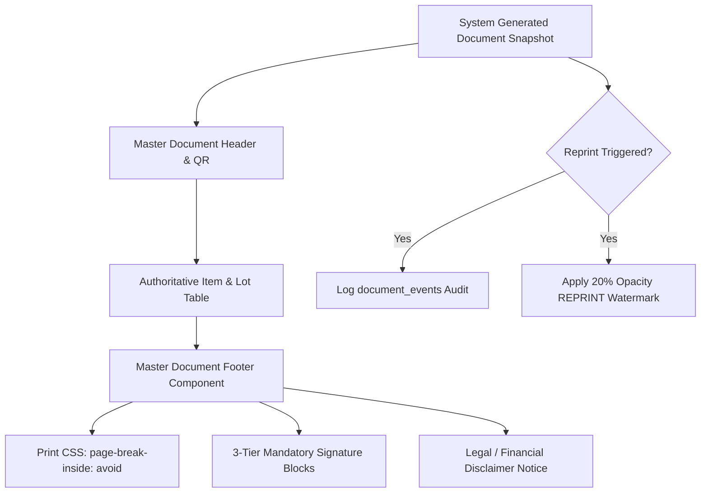

# Dyna-Serv WIMS — Document Printing & Compliance Companion Guide

**Canonical manual:** [Unified User Manual](../USER_MANUAL.md)  
**Status:** Companion chapter; reconcile with the unified manual whenever workflow rules change.  
**Last reconciled:** 2026-10-27

## Chapter: Warehouse Document Printing, Signatures & Compliance Standards

---

### 1. Overview of Physical Document Integrity

Dyna-Serv WIMS enforces strict physical and cryptographic standards for all warehouse paperwork. Whether goods are entering through a **Warehouse Receiving Report (WRR)**, moving across racks on a **Pick List**, or departing with a carrier on a **Delivery Receipt / Acknowledgement Receipt (DR/AR)**, all printed documents must maintain unbroken legal accountability.



---

### 2. Standardized Document Footer & 3-Tier Sign-Off

All official operational documents implement the [`MasterDocumentFooter`](../../components/print/MasterDocumentFooter.tsx) component. This ensures unified formatting, font sizing, and legal sign-off hierarchies across the entire facility.

#### The Three Default Accountability Roles

Unless explicitly overridden by a specialized workflow, printed documents must include the following three signature blocks:

| Role Title | Subtitle / Function | Operational Responsibility |
| :--- | :--- | :--- |
| **Prepared By:** | `Floor Staff / Receiver` | Physical personnel who received, counted, or physically picked the cartons from racks. Attests that goods were physically handled. |
| **Checked & QC Verified By:** | `QC Inspector / Lead` | Quality assurance officer or team lead who verified barcode accuracy, packaging integrity, lot codes, and quantity tallies. |
| **Authorized Supervisor:** | `Warehouse Supervisor Approval` | Shift supervisor or warehouse operations manager who authorizes inventory commitment, dispatch release, or exception overrides. |

#### Print Engine & Page-Break Protection

In warehouse thermal and laser printing environments, page splits frequently orphan signatures onto a blank second sheet. The document engine injects strict print CSS:

```css
@media print {
  .master-print-footer {
    page-break-inside: avoid !important;
    break-inside: avoid !important;
  }
}
```

* **Guarantee**: The signature blocks, date lines, and confidentiality disclaimers are locked together and will never break across a page division. If insufficient space remains on the active page, the print engine gracefully carries the footer block intact to the next page.

---

### 3. Document Reprinting & Watermark Security

When an already-generated document must be reprinted (e.g., thermal printer jam, damaged paper on the floor, customer request for duplicate paper), the system prevents fraudulent paper duplication through cryptographic tracking:

1. **Reprint Action Audit**:
   * Any reprint initiated from `/documents` creates an immutable entry in the `document_events` ledger recording `event_type = 'reprinted'`, the acting user's ID, and an Asia/Manila timestamp.
2. **Mandatory Visual Watermark**:
   * All duplicate prints automatically render a diagonal, high-contrast watermark across the document surface:
     $$\text{REPRINT — [ISO Timestamp Asia/Manila] (20\% Opacity)}$$
   * Original documents do not bear this watermark. Customs (PEZA), security guards, and finance officers use this indicator to detect duplicate withdrawal attempts.

---

### 4. Pricing Treatment & Disclaimers

The footer features configurable disclaimer notices (`showDisclaimer = true`) reflecting the underlying inventory model:

* **Trading Model Documents**:
  * Prices shown on Trading Pick Lists and Acknowledgement Receipts are final commercial transaction amounts as established in `13-trading-orders-and-pricing`.
* **VMI Model Documents**:
  * Prices shown on VMI Delivery Receipts are per-release reference values only. The official financial liability is governed by the monthly Statement of Account (SOA) and period-average billing calculation (`12-vmi-billing`).
* **Confidentiality Notice**:
  * Default footer disclaimer: `"Dyna-Serv Warehouse Inventory Management System • Confidential Warehouse Document"`.

---

### 5. Permanent Tiered Retention Policy

All generated warehouse documents (`generated_documents` table and stored PDF artifacts) follow Dyna-Serv's permanent retention policy:

1. **Hot Tier (Years 0–3)**:
   * Stored in Supabase Private Storage (`documents` bucket).
   * Instantly previewable and downloadable from the central `/documents` archive.
2. **Cold Tier (Years 3+)**:
   * Archived off-platform to secure cold object storage with SHA-256 hash verification.
   * Supabase hot copy is pruned only after successful checksum verification.
   * **Documents are permanently retained and never deleted.**

---

### 6. Uniform preview and PDF typography

All official warehouse-document previews and generated PDFs use the shared document contract:

- Font size: **11pt for all document text**.
- Font family: one Helvetica-family system stack (`Helvetica Neue`, Helvetica, Arial, sans-serif).
- No separate heading, body, or monospace typeface is used in the document surface.
- The same rule applies before printing in the live preview, so the preview is a reliable representation of the PDF typography.

If an old preview remains visible after deployment, hard-refresh the page (`Ctrl+F5`) and reopen the document. This does not change operational data or document identity.
